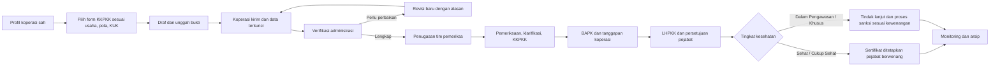

# Proses bisnis ujung ke ujung

## A. Registrasi dan pemutakhiran koperasi

1. Admin mengimpor snapshot ODS atau menambahkan koperasi secara manual dari data ODS dengan NIK, nomor badan hukum, jenis, bentuk, pola, wilayah, dan sumber bertanggal.
2. Sistem mencari kecocokan NIK terlebih dahulu, lalu nomor badan hukum. Nama provinsi/kabupaten/kecamatan/desa dari ODS dipetakan ke kode wilayah Kemendagri yang berlaku; nama ambigu masuk antrean verifikasi. Rekaman yang meragukan tidak dibuat sebagai koperasi baru secara diam-diam.
3. Admin menetapkan kewenangan kabupaten/provinsi/nasional berdasarkan wilayah keanggotaan dan dasar legalitas. Koperasi luar kewenangan tetap dapat dicatat sebagai objek koordinasi/pemantauan cabang.
4. Pengurus mengajukan akun untuk koperasi yang ada; admin memverifikasi hubungan pengurus dengan koperasi. Satu koperasi dapat memiliki lebih dari satu pengguna dengan pembatasan internal.
5. Perubahan identitas penting memerlukan verifikasi admin dan menyimpan nilai sebelumnya. Status aktif ODS tidak otomatis berarti sehat atau patuh.

## B. Penilaian mandiri → pemeriksaan → hasil resmi

**Aturan status:** `draf → dikirim_terkunci → diverifikasi_berkas / perlu_revisi → ditugaskan → diperiksa → BAPK_ditandatangani → LHPKK_disetujui → keputusan_terbit → tindak_lanjut/selesai`. Penolakan, pembatalan, dan revisi selalu mempunyai alasan dan jejak audit. Pemeriksaan resmi tidak dapat melompati penugasan, KKPKK, BAPK, dan persetujuan LHPKK.

**Batas peran:** skor mandiri adalah perkiraan dan tidak boleh tampil sebagai sertifikat resmi. Pemeriksa mencatat fakta, koreksi dan temuan pada kertas kerja. Pejabat berwenang menetapkan sertifikat atau tindak lanjut sesuai LHPKK. Sertifikat kesehatan hanya untuk predikat **Sehat** atau **Cukup Sehat** menurut [Permenkop UKM 9/2020 Pasal 15–16](https://peraturan.bpk.go.id/Details/160765/permenkop-ukm-no-9-tahun-2020).

**Kunci setelah isi:** koperasi bebas mengubah draf. Saat menekan **Kirim final**, sistem menampilkan ringkasan dan meminta konfirmasi. Versi terkirim beserta lampiran, formula, dan hasil dihitung sebagai snapshot yang tidak dapat ditimpa. Jika verifikator mengembalikan, sistem membuat revisi baru; versi lama tetap utuh. Setelah BAPK/LHPKK ditandatangani, perubahan hanya melalui addendum atau pemeriksaan baru, bukan sunting diam-diam.

**Sinkron pengawasan:** nilai dan temuan hasil pemeriksaan yang sudah disahkan mengisi register monitoring internal. Pemetaan ke Google Sheet dilakukan dari dataset yang sama melalui ekspor terkontrol atau integrasi berizin. Perubahan di Google Sheet tidak boleh menimpa hasil KKPKK sah tanpa rekonsiliasi.

## C. Rencana pengawasan dan pembinaan

1. Pimpinan menetapkan sasaran tahunan berdasar KUK, riwayat temuan, RAT, pengaduan, kondisi keuangan, dan kewenangan.
2. Koordinator membuat penugasan tim, surat tugas, jadwal pemeriksaan rutin atau sewaktu-waktu.
3. Petugas menggunakan profil yang sudah ada, memeriksa dokumen, melakukan klarifikasi, dan mencatat bukti serta temuan.
4. Temuan menghasilkan rekomendasi, pemilik tindakan, tenggat, dan bukti penyelesaian. Petugas memverifikasi penutupan temuan.
5. Hasil dipakai untuk pembinaan: klinik administrasi, pendampingan RAT, pelatihan pengurus, pembenahan pembukuan, dan penguatan usaha.

## D. Layanan pendampingan perizinan KSP/USP

1. Pemohon memilih KSP, KSPPS, USP, atau USPPS, wilayah kerja, dan status pendirian. Sistem menampilkan syarat yang relevan berdasarkan standar yang berlaku.
2. Pemohon mengisi cek kesiapan dan melampirkan berkas yang benar-benar dibutuhkan; petugas memeriksa dan memberi catatan per dokumen.
3. Sistem menyediakan tautan resmi OSS dan panduan langkah, serta mencatat NIB/izin dan status yang dilaporkan pemohon.
4. Bila kewenangan daerah dan integrasi OSS tersedia secara resmi, proses verifikasi dapat dihubungkan; sampai saat itu sistem adalah **pendampingan/registrasi layanan**, bukan penerbit izin tandingan.
5. Izin yang terbit diverifikasi petugas dan disimpan pada profil koperasi; masa berlaku/kewajiban berikutnya menjadi pengingat.

Dasar perizinan yang digunakan saat ini adalah [PP 28/2025](https://peraturan.bpk.go.id/Details/319773/pp-no-28-tahun-2025), [Permenkop 4/2025](https://jdih.kop.go.id/doc/detail/doc-1205-v_peraturan), [Permenkop UKM 8/2023](https://peraturan.bpk.go.id/Details/260414/permenkop-ukm-no-8-tahun-2023), serta prosedur OSS yang berlaku. PP 28/2025 mencabut PP 5/2021; daftar syarat dan alur tidak boleh dikunci permanen di kode aplikasi.

## E. KDKMP dan GIS

1. Admin mengaitkan KDKMP dengan satu identitas koperasi dan satu lokasi desa/kelurahan; jenis KDKMP dicatat pada master hukum, tahap pembangunan/operasional dicatat terpisah.
2. Petugas/verifikator mencatat target, progres fisik, foto, koordinat, hasil verval, kendala, dan berita acara. Bukti memiliki tanggal, sumber, dan status verifikasi.
3. KDKMP mencatat komoditas unggulan, satuan, kapasitas, musim, mitra, sarana, dan kebutuhan pendampingan. Angka usaha hanya dihitung jika periode dan satuannya jelas.
4. Dashboard menghitung capaian 100% dari lokasi yang memenuhi kriteria disetujui. Peta publik hanya menampilkan titik/foto yang telah lolos moderasi.

## F. Aduan, konsultasi, dan tindak lanjut

1. Warga/anggota memilih **konsultasi**, **aduan layanan**, atau **dugaan masalah koperasi**. Form meminta data minimum dan menghasilkan nomor tiket.
2. Admin melakukan triase: kewenangan, urgensi, duplikasi, dan perlindungan identitas. Kasus di luar kewenangan dicatat untuk rujukan, bukan dibuang.
3. Petugas meminta klarifikasi, melakukan pemeriksaan bila perlu, mencatat percakapan, bukti, serta berita acara penanganan.
4. Pengadu mendapat pembaruan status yang aman; dokumen internal dan identitas pihak lain tidak dibuka.
5. Kasus ditutup setelah hasil dan tindak lanjut dicatat, dengan mekanisme buka kembali bila ada bukti baru.

## G. Siklus pelaporan

Setiap bulan sistem menyiapkan rekap untuk pimpinan: jumlah koperasi per kewenangan/status, RAT, cakupan pemeriksaan, predikat kesehatan resmi, temuan, pembinaan, layanan izin, aduan, dan KDKMP. Petugas meninjau anomali lalu menyetujui snapshot laporan. Laporan historis tidak berubah ketika data sumber diperbarui di kemudian hari.
