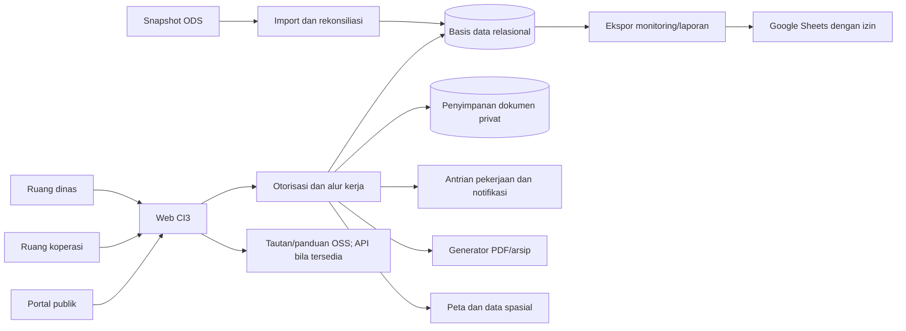

# Rencana implementasi aplikasi CI3

**Catatan status 5 November 2026:** fondasi tahap 1 sudah berjalan di domain, namun dokumen, CMS publik, impor melalui UI, dan riwayat master lengkap belum selesai. Tahap 2–4 tetap backlog. Hasil sebenarnya dan urutan lanjutan ada pada [10-status-implementasi.md](10-status-implementasi.md) dan [13-prioritas-rilis-berikutnya.md](13-prioritas-rilis-berikutnya.md).

## Urutan pembangunan

| Tahap | Hasil yang dapat dipakai | Kriteria selesai |
|---|---|---|
| 0. Validasi proses dan data | Daftar pemilik proses, contoh kasus, katalog master dan CRUD, sumber kode wilayah Kemendagri, keputusan kewenangan, peta formulir/rumus, desain layar | Pejabat pengawas menyetujui aturan jalur KKPKK, template BAPK/LHPKK, batas publikasi dan alur penerbitan |
| 1. Fondasi dan layanan dasar | CI3, login, hak akses per modul/aksi, audit, halaman CRUD semua master, impor wilayah provinsi–desa/kelurahan, master koperasi, impor ODS, profil 360°, dokumen, CMS publik | Setiap master punya daftar/tambah/detail/ubah/arsip/riwayat; hierarki wilayah valid; 524 entri kabupaten diimpor tanpa duplikat; 33 entri lintas kewenangan tetap dikenali |
| 2. Penilaian dan pengawasan | Delapan jalur formulir, draf/kunci/revisi, verifikasi, penugasan, KKPKK, BAPK, LHPKK, sertifikat/tindak lanjut | Kasus uji per jalur cocok dengan workbook sumber; versi final tidak dapat ditimpa; keluaran resmi memerlukan persetujuan |
| 3. Program dan layanan | KDKMP, GIS, aduan, pembinaan, cek izin dan tautan OSS, dashboard pimpinan | Progres 100% berbasis bukti; peta memisah data publik/privat; tiket aduan dapat ditelusuri; izin tidak diterbitkan lokal tanpa wewenang |
| 4. Integrasi dan penyempurnaan | Pemetaan Google Sheet, ekspor laporan, integrasi resmi bila tersedia, notifikasi, analitik/evaluasi | Rekonsiliasi teruji, tidak ada timpa otomatis hasil resmi, laporan historis tetap stabil |

Tahap 0–2 menghasilkan inti sistem informasi, bukan sekadar situs profil. Durasi dan biaya baru diperkirakan setelah jumlah pengguna, infrastruktur, serta kesiapan integrasi dan rumus KKPKK diverifikasi.

## Arsitektur kerja

CI3 dipakai sebagai kerangka utama sesuai permintaan. Implementasi memakai struktur modul yang jelas di dalam CI3, migrasi basis data, layanan domain untuk aturan penilaian, dan antarmuka responsif. PHP, pustaka, basis data, dan server dipilih setelah audit kompatibilitas CI3 dan kebijakan infrastruktur dinas. Keamanan dasar: koneksi HTTPS, kata sandi hash, sesi dan CSRF, validasi server, pembatasan unggah, dokumen privat di luar akses web langsung, otorisasi pada setiap aksi, log audit, cadangan serta uji pemulihan. Kebijakan retensi dan akses data pribadi diselaraskan dengan [UU 27/2022 tentang Pelindungan Data Pribadi](https://peraturan.bpk.go.id/Details/229798/uu-no-27-).

## Keputusan rancangan yang sudah diambil

1. **ODS adalah sumber rujukan identitas**, namun perubahan manual oleh admin diperbolehkan dengan bukti sumber, alasan, dan status verifikasi. Data lokal tidak mengaku menjadi ODS resmi.
2. **Kode wilayah Kemendagri adalah master berversi.** Provinsi, kabupaten/kota, kecamatan, dan desa/kelurahan mempunyai halaman CRUD masing-masing; perubahan kode resmi tidak menimpa riwayat alamat. Rincian ada di dokumen 08.
3. **Satu koperasi, banyak periode.** RAT, keuangan, penilaian, temuan, dan sertifikat selalu melekat pada tahun/periode; dashboard dapat membedakan tren dan snapshot.
4. **Form kesehatan berversi.** Pertanyaan dan rumus dipilih oleh jenis kegiatan, pola, dan KUK. Kunci final dilaksanakan pada level versi pengiriman, bukan melarang koreksi yang sah.
5. **Hasil resmi memerlukan pejabat.** Perhitungan dan berita acara otomatis membantu kerja petugas, tetapi tidak menggantikan pemeriksaan, tanda tangan, atau penetapan.
6. **Monitoring memakai data pemeriksaan yang sama.** Register internal menjadi sumber ekspor; Google Sheet adalah keluaran/referensi rekonsiliasi sampai integrasi disetujui.
7. **OSS tetap kanal perizinan resmi.** Modul lokal membantu kesiapan dan memantau layanan, dengan syarat yang dapat diperbarui sesuai regulasi.
8. **GIS dua tingkat.** Titik internal dapat lebih rinci; peta publik memakai lokasi dan foto yang disetujui agar data sensitif tidak bocor.

## Validasi yang wajib sebelum penetapan resmi

- Pejabat terkait memastikan apakah daftar 524 entri benar merupakan seluruh binaan/kewenangan Kabupaten Rembang, serta bagaimana mencatat cabang koperasi provinsi/nasional.
- Pengawas memeriksa kedelapan workbook terhadap Juknis 15/2021: indikator, bobot, ambang predikat, pembulatan, dan penerapan pada USP/USPPS koperasi non-KSP. Berkas `STUDI KASUS` dipakai sebagai pembanding, bukan satu-satunya bukti benar.
- Pemilik proses mengesahkan template BAPK, LHPKK, sertifikat, berita acara aduan, kop, nomor, dan pejabat penandatangan.
- Dinas menentukan akun layanan dan pemilik Google Sheet untuk integrasi, serta apakah sinkronisasi hanya ekspor atau dua arah. Proses dua arah baru dirancang setelah aturan konflik dan izin tertulis tersedia.
- Penanggung jawab layanan perizinan mengonfirmasi pembagian peran Dinas, DPMPTSP/OSS, dan kewenangan sesuai lokasi/wilayah kerja pada aturan terbaru.
- Pemilik data menentukan daftar foto, titik koordinat, dan indikator yang boleh dipublikasikan.

## Skenario penerimaan prioritas

1. Import ODS dua snapshot tidak membuat 524 koperasi ganda; 33 koperasi lintas kewenangan terbaca sebagai entitas tersendiri.
2. Koperasi KDKMP non-KSP syariah KUK 2 masuk varian formulir yang tepat; koperasi dengan USP memunculkan kebutuhan verifikasi jalur, bukan dipaksa ke varian otomatis yang salah.
3. Setelah pengiriman final, perubahan jawaban lama ditolak; pengembalian beralasan membuat versi revisi dan kedua versi dapat diaudit.
4. Skor KKPKK dari sampel setiap jalur sama dengan workbook acuan setelah aturan pembulatan disepakati; pembagi nol menghasilkan status perlu klarifikasi.
5. BAPK memakai temuan yang sama dengan LHPKK dan register monitoring; penyelesaian temuan tidak menghapus isi berita acara awal.
6. Sertifikat hanya terbit untuk LHPKK sah dengan predikat sehat/cukup sehat dan penetapan pejabat yang tepat.
7. Aduan rahasia dan dokumen keuangan tidak muncul melalui URL langsung, API, pencarian publik, atau ekspor yang tidak berhak.
8. Progres KDKMP 100% tidak bertambah sebelum bukti tervalidasi; perubahan target atau definisi capaian tercatat.
