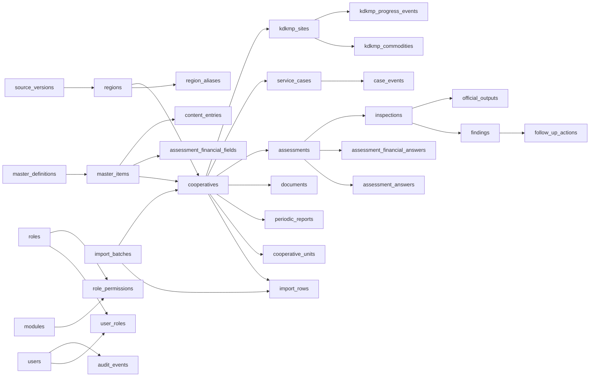

# Rancangan basis data dan keputusan skema

Skema yang sudah diterapkan ada di [`../../database/schema.sql`](../../database/schema.sql) (baseline 001) serta migrasi [`../../database/002_assessment_rules.sql`](../../database/002_assessment_rules.sql) sampai [`../../database/017_report_separation.sql`](../../database/017_report_separation.sql), MariaDB 10.11, `utf8mb4`, InnoDB. Migrasi 001–017 kini memuat **36 tabel**. Jalankan `python3 scripts/migrate.py` untuk menerapkan migrasi yang belum tercatat. Identitas internal memakai ID numerik, sementara NIK, nomor badan hukum, kode wilayah Kemendagri, nomor dokumen, dan kode master tetap teks. Kunci asing mencegah baris yatim; transaksi resmi tidak dihapus untuk mempertahankan jejak.

## Peta relasi inti

## Kelompok tabel dan kunci penting

| Kelompok | Tabel | Keputusan agar pertumbuhan modul tidak memerlukan pemindahan identitas |
|---|---|---|
| Versi dan wilayah | `schema_migrations`, `source_versions`, `regions`, `region_aliases` | Kode Kemendagri unik sebagai teks; setiap tingkat punya `parent_id`; sumber versi tercatat; alias nama ODS terpisah. |
| Kamus | `master_definitions`, `master_items` | 39 definisi dengan item berkode, status, periode berlaku, metadata, dan sumber; tipe koperasi/KKPKK/layanan/KDKMP dapat bertambah tanpa kolom baru per pilihan. |
| Akses | `users`, `roles`, `modules`, `user_roles`, `role_permissions` | Satu pengguna bisa memiliki beberapa peran; izin dipasang per modul dan aksi. Akun koperasi dapat terhubung ke satu profil koperasi. |
| Asal data | `import_batches`, `import_rows` | Hash SHA-256 berkas mencegah impor batch sama dua kali; nomor baris dan JSON asal mempertahankan keterlacakan. |
| Inti koperasi | `cooperatives`, `cooperative_units`, `periodic_reports`, `documents` | NIK unik bila ada, kewenangan dan `reference_only` terpisah; unit USP/USPPS tidak dipaksakan sebagai jenis koperasi; laporan berperiode; dokumen punya hash, jenis, status verifikasi, dan visibilitas. |
| Penilaian dan pengawasan | `assessments`, `assessment_answers`, `assessment_financial_answers`, `assessment_form_versions`, `assessment_indicators`, `assessment_financial_fields`, `assessment_form_snapshots`, `inspections`, `findings`, `follow_up_actions`, `official_outputs` | Penilaian memiliki jalur, versi, tahun, revisi, kunci waktu; sel rekening menyimpan periode dan sumber workbook; pemeriksaan/temuan/tindak lanjut terhubung; keluaran resmi berversi dan berstatus. |
| Layanan | `service_cases`, `case_events` | Aduan, konsultasi, pendampingan izin, dan pembinaan berbagi pola tiket, PIC, tenggat, dan kronologi. |
| KDKMP dan GIS | `kdkmp_sites`, `kdkmp_commodities` serta koordinat di `cooperatives` | Lokasi KDKMP melekat ke desa dan koperasi, progres fisik dipisah dari status verifikasi; komoditas berperiode dan bersatuan. Titik koperasi tidak disamakan dengan kode wilayah. |
| Konten publik | `content_entries` | Judul, kategori master, ringkasan, isi/tautan HTTPS, foto, tanggal agenda, status draf/tayang/arsip, dan jejak editor. |
| Profil institusi | `organization_profile` | Satu baris identitas OPD dan teks publik; logo/favicon disimpan sebagai path, diperbarui oleh admin berizin dan diaudit. |
| Audit | `audit_events` | Aktor, entitas, aksi, nilai sebelum/sesudah, IP, dan waktu untuk perubahan data penting. |

## Aturan lintas modul

1. **Kewenangan:** `authority_scope` menjelaskan kabupaten/provinsi/nasional/belum pasti. `reference_only=1` membuat 33 entri luar kewenangan tetap dapat dicari dan dipetakan tanpa masuk antrian keputusan kabupaten. Bentuk `primer/sekunder` berada di master terpisah; label sumber ODS seperti `Primer Provinsi` tetap tersimpan di baris impor.
2. **Periode dan versi:** RAT dan keuangan unik menurut koperasi+tahun buku. Penilaian menyimpan `fiscal_year`, `form_item_id`, `form_version`, `revision_no`, `supersedes_id`, dan `locked_at`. Dokumen dan keluaran resmi menyimpan revisi sendiri. Hasil final tidak boleh diubah langsung saat modul transaksi dibangun.
3. **Satu fakta untuk banyak keluaran:** temuan melekat ke pemeriksaan, tindakan melekat ke temuan. BAPK, LHPKK, register pengawasan, dan ekspor Google Sheet mengambilnya dari identitas yang sama, tanpa entri ulang. Integrasi Sheet membutuhkan tabel job/sinkronisasi tambahan pada migrasi berikutnya.
4. **Unggah privat:** tabel `documents` menyimpan lokasi fisik dan hash; berkas produksi harus berada di area privat dengan unduh lewat pemeriksaan izin. Kolom visibilitas tidak otomatis menjadikan berkas aman untuk publik.
5. **Status sebagai alur:** perubahan status penilaian, verifikasi, aduan, dan penerbitan dilakukan oleh layanan domain dengan izin dan audit; nilai status di database bukan izin untuk melewati persetujuan.
6. **Kualitas geografis:** koordinat desimal diperiksa pasangan dan rentangnya; master wilayah dari keputusan dipakai sebagai referensi administratif, bukan sebagai geometri batas.

## Catatan penajaman sebelum modul transaksi dibuka

Skema baseline sudah menyediakan relasi utama, tetapi **tidak berarti aturan penilaian dan dokumen resmi sudah final**. Migrasi 002 sudah mengatasi `unit_id=NULL` dengan kolom kunci hasil `IFNULL(unit_id,0)` (MariaDB mengizinkan beberapa NULL dalam indeks unik), serta menyediakan definisi formulir/indikator berversi dan snapshot pertanyaan per asesmen. Rumus konkretnya belum ditranskripsi dan disahkan. Tabel `document_versions`/nomor naskah perlu disesuaikan dengan template yang disahkan. Tambahkan `case_attachments`, kanal kontak, penugasan pemeriksa jamak, dan bukti progres KDKMP ketika prosesnya disetujui. Keputusan ini dicatat sekarang supaya pengembangan berikutnya memperluas baseline secara terarah, bukan mengganti identitas koperasi atau wilayah.

Wilayah 2025 diambil dari lampiran Kepmendagri **300.2.2-2138/2025**. Keputusan perubahan **300.2.2-2430/2025** sudah dicatat sebagai sumber yang harus direkonsiliasi; perubahan lampirannya belum ditimpa ke tabel. Pembaruan berikutnya harus menampilkan selisih dan meminta persetujuan operator sebelum status wilayah aktif berubah.

## Migrasi yang telah diterapkan setelah baseline

| Versi | Isi |
|---|---|
| 004 | Hak akses penilaian untuk peran koperasi yang terhubung ke satu profil |
| 005 | Membuat 294 profil lokasi KDKMP dari entitas awal tanpa menganggap sudah terbangun |
| 006 | Riwayat perubahan progres KDKMP (`kdkmp_progress_events`) |
| 007 | Jenis dokumen awal untuk asesmen |
| 008 | `content_entries` dan kategori galeri/kanal sosial |
| 009 | Definisi sel rekening per versi KKPKK dan jawaban keuangan per asesmen |
| 010 | Hash kode akses pribadi untuk pelacakan aduan publik |
| 011 | Hak verifikasi untuk peran admin pada penilaian, pengawasan, dan KDKMP |
| 012 | Profil institusi dan izin lihat/ubah profil dinas |
| 013 | Arsip koperasi/lokasi KDKMP dan izin ubah profil sendiri untuk akun koperasi |
| 014 | Izin membatalkan draf penilaian milik akun koperasi |
| 015 | Izin menambah unit USP/USPPS milik akun koperasi |
| 016 | Modul dan alur verifikasi laporan tahunan, catatan verifikator |
| 017 | Kolom pembuat/penyunting terakhir agar verifikasi tidak dilakukan oleh orang yang sama |

Delapan versi formulir dan 1.384 indikator biner dimuat oleh `scripts/seed_kkpkk.py`; 2.098 sel input rekening dimuat oleh `scripts/seed_financial_inputs.py` tanpa menyalin angka contoh. Keduanya data, bukan SQL migrasi skema. Penjelasan batas formula dan hasil uji ada di dokumen 14.
